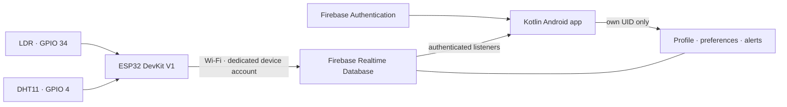

# DARKTEMP

**DARKTEMP: An IoT-Based Darkness and Temperature Monitoring System.**

An Android capstone app for monitoring ambient room temperature and LIGHT/DARK status from an ESP32. Sensor readings and history come only from real sampling events. The app includes email/password accounts, a two-step registration flow, a live dashboard, per-account temperature units and limits, temperature and light-change alert preferences, and a persistent alert inbox.



The app measures ambient conditions. DARK means the LDR detected little light; it does not establish a power outage. The DHT11 reading is not freezer temperature or a food-safety measurement.

## Open and build

Use Android Studio with JDK 17 or 21 and Android SDK 36. Minimum supported phone version is Android 8.0 (API 26). Gradle downloads pinned dependencies on first build. Versions and official compatibility references are in [docs/TOOLCHAIN.md](docs/TOOLCHAIN.md).

From PowerShell:

```powershell
Set-Location 'C:\Users\ark\Desktop\DarkTemp'
.\scripts\build.ps1
```

The helper selects an installed JDK and runs `assembleDebug`, `testDebugUnitTest`, and `lintDebug`. If your PowerShell policy blocks the helper:

```powershell
powershell -ExecutionPolicy Bypass -File .\scripts\build.ps1
```

Or set `JAVA_HOME` to your installed JDK and run the wrapper directly:

```powershell
$env:JAVA_HOME = 'C:\Program Files\Android\openjdk\jdk-21.0.8'
.\gradlew.bat testDebugUnitTest
.\gradlew.bat assembleDebug
.\gradlew.bat lintDebug
```

Adjust the JDK path on another computer. Set the SDK location in Android Studio, or create an ignored `local.properties` containing `sdk.dir=C:/Android` with your actual SDK directory. The debug APK is `app/build/outputs/apk/debug/app-debug.apk`. Open this folder in Android Studio and run the `app` configuration on an emulator or a USB-debugging-enabled phone.

**Firebase credentials are not included.** The unconfigured APK intentionally opens a “Firebase setup required” screen. It does not authenticate users or display invented readings. The Google Services plugin is applied only when a real `app/google-services.json` is present.

## Connect your system

1. Follow [FIREBASE_SETUP.md](FIREBASE_SETUP.md): register **`com.darktemp.app`**, enable Email/Password, create Realtime Database in locked mode, and download the configuration after database creation.
2. Create the dedicated device account, replace the device UID placeholder in [database.rules.json](database.rules.json), and publish the rules to your project.
3. Place the real `google-services.json` in `app/` and rebuild. Register in the app, then manually sign in as required by the registration flow.
4. Follow [FIRMWARE_SETUP.md](FIRMWARE_SETUP.md): wire the sensors, copy `secrets.example.h` to ignored `secrets.h`, enter your actual connection values, install the pinned libraries, and upload the sketch.
5. Check Serial Monitor at **115200 baud**, then verify the dashboard, historical entries, and alert transitions with [TESTING.md](TESTING.md).

Use a separate Firebase Authentication account for the ESP32. Do not put an Admin SDK key in Android or firmware. Microcontroller passwords can be extracted from flash; this is a restricted student-prototype identity, not production hardware identity.

## Project map

```text
app/
  src/main/java/com/darktemp/app/
    core/config/       Firebase initialization and monitoring constants
    core/navigation/   Authentication/session navigation and main tabs
    core/ui/           Navy/teal theme, shared controls, date display
    core/util/         Tested validation, conversion, and alert decisions
    data/model/        Typed profile, settings, readings, and alerts
    data/firebase/     Strict mapping and cancellable Firebase operations
    data/repository/   Authentication and database access
    feature/auth/      Login, two registration steps, reset, recovery
    feature/dashboard/ Monitoring ViewModel and live dashboard
    feature/history/   Latest 100 real samples, filterable by light status
    feature/notifications/ Personal temperature and light alert inbox
    feature/settings/  Account, password, unit, alert limits, sign-out
  src/main/res/        Original supplied branding and Android resources
  src/test/            Pure business-rule tests
  src/androidTest/     Unconfigured launch smoke test
firmware/esp32_darktemp/ Arduino sketch, config, secrets template
rules-tests/           Local Firebase Security Rules tests
database.rules.json    Deny-by-default rules; device UID placeholder
database.schema.md     Final paths, fields, units, and timestamp contract
firebase.json          Rules and local emulator configuration
scripts/               Windows build helper
docs/                  Toolchain references and verification artifacts
```

The original supplied wordmark is used on authentication screens and the original icon on the launcher; their aspect ratios are preserved. The additional supplied reference remains in `branding/`.

## Behavior and architecture

One Activity hosts Compose navigation. ViewModels expose observable state, and repositories own Firebase references. A single session-scoped monitoring ViewModel serves every main tab. Lifecycle cancellation removes sensor/user listeners when the app leaves the foreground, and signing out disposes of that user's state. Firebase Authentication retains normal login sessions across restarts. Successful registration first confirms the profile/default settings write, then signs out and returns to Login. Interrupted profile creation is recoverable after signing in.

The dashboard labels data fresh only within **90 seconds**, with a small clock-skew tolerance. Database connectivity and sensor-data freshness are separate. Missing or malformed readings never become a plausible zero or a fabricated online status. Canonical values stay in Celsius; choosing Fahrenheit changes presentation and converts entered limits back to Celsius.

Temperature and light-change alerts are created only while the app actively monitors valid, fresh readings. Temperature alerts trigger on zone crossings; light alerts trigger on changes between `LIGHT` and `DARK` after an initial baseline sample. Disabled alert types still advance processed state, so re-enabling does not replay an already observed condition. A transaction saves alerts and processed state together; retries and concurrent app sessions cannot duplicate alerts. Clearing the inbox preserves that state. History filters the newest 100 real samples by light status. Password changes require re-entering the current password. See [database.schema.md](database.schema.md) for the exact storage contract.

The ESP32 writes latest and history atomically with an original unique history ID reused on retries. It waits for synchronized network time and skips failed DHT11 readings. It retains at most one pending event with bounded retries; gaps during long outages are expected. No background push, Cloud Functions, Firestore, FCM, charts, or unrelated features are included.

## Tests and limitations

[TESTING.md](TESTING.md) records commands, actual verification results, and the complete Firebase/hardware acceptance checklist. Local emulator tests exercise security boundaries using test-only identities; they do not connect to or seed a live project.

This project supports one shared sensor, `device001`. Anyone able to create an ordinary account in this Firebase project can read that shared sensor. Profiles, preferences, and alerts remain private to each UID. Alert history and sensor history grow in Firebase; establish retention before long-term deployment. The Android history query shows the newest 100 readings. Foreground alerts can miss crossings that occur while no app is open. Phone/ESP32 clock errors can affect freshness; keep automatic time enabled. Physical sensor accuracy, wiring, Wi-Fi, account permissions, and cloud operation require the owner's real setup.

## Troubleshooting

| Symptom | Check |
|---|---|
| Setup-required screen | Put the correct JSON in `app/`, confirm it contains the Realtime Database URL, rebuild and reinstall. |
| Package mismatch during build | Register/download for `com.darktemp.app`; do not rename only one Gradle field. |
| Authentication unavailable | Enable the Email/Password provider and check connectivity/password policy. |
| Profile setup failed after account creation | Sign in with that account and complete recovery; inspect deployed rules. |
| Database permission denied | Correct dedicated device UID in rules; ordinary users cannot upload sensor data. |
| Dashboard waiting | Read Serial Monitor; verify device auth, real database URL, NTP, DHT11, and upload diagnostics. |
| Reading is stale | Check device uploads, Wi-Fi and clock; the app does not imply a power outage. |
| LIGHT/DARK seems reversed | Inspect/calibrate the divider polarity and threshold in firmware `config.h`. |
| No alert | App must be open, alerts enabled, reading fresh/new, and zone must cross a limit. |
| Gradle uses an incompatible Java | Run `scripts/build.ps1 -JavaHome` with a JDK 17/21 directory. |
